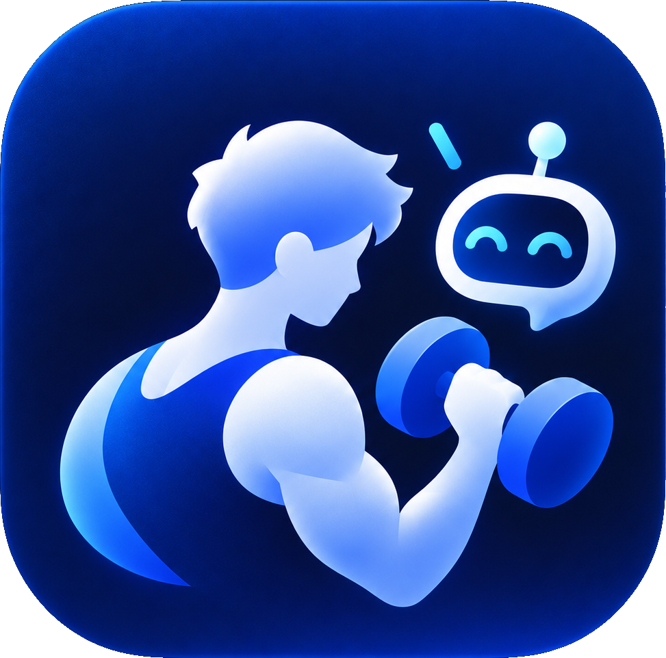

<p align="center"></p>

# BumpPump · 泵碰

记录每一餐、每次训练，看见自己的进步。

[下载 App](https://github.com/yilin209107/BumpPump/releases) · [反馈问题](https://github.com/yilin209107/BumpPump/issues)

原生 macOS 健身与营养记录 App，支持手动记录和 App 内 AI 助理。面向增肌、减脂及希望了解自己日常生活的人。

## 功能

- 早餐、午餐、晚餐、加餐的营养环图和实际份量换算，支持 kcal / kJ。
- 力量训练按动作、组数、次数、重量及左右侧记录；按训练日期显示分组柱图。
- 有氧、体重趋势、每日摄入和黄色热量目标参考线。
- 固定窗口内的侧边助理，流式回复，支持图片、文字文件和文字 PDF。
- 助理通过受控工具查询及修改 App 内记录，操作有回执、冲突保护和撤销。
- 系统深浅色、Liquid Glass 控件、首次可见入场动画与指针光晕。

## 第一次使用

下载最新 Release 中的 `BumpPump-macOS-arm64-v1.0.1.zip`，解压后把 BumpPump.app 拖入 Applications。

首次打开进入设置，可以先选手动模式。App 不附带个人记录、聊天、食品标签或 API Key；填写自己的数据即可使用。再次启动直接进入主页。

助理使用自己的服务商 API Key；Shift+Enter 发送，Enter 换行。图片理解取决于所选模型能力。

**平台：Apple Silicon，macOS 14+；Liquid Glass 需要 macOS 26+。** 当前安装包为本机 ad-hoc 签名，尚未完成 Apple Developer ID 签名与公证。

## 数据与隐私

记录保存在本机 SQLite，API Key 在 App 自己的本机目录加密保存。新安装使用独立的 `app.bumppump.mac` 身份和存储目录。

只有主动发送消息或测试连接时才请求 AI 服务商。对话、所选附件和助理查询到的相关记录直接发送给所选服务商，可能产生 API 费用。项目没有中转服务器。

详情：[隐私说明](docs/PRIVACY.md) · [安装说明](docs/INSTALL.md) · [发布指南](docs/RELEASE.md)

## 从源码构建

需要 Apple Silicon Mac、Swift 和 macOS 26+ SDK。

```sh
./script/build.sh --run
./script/check_home.sh
./script/check_agent.sh
./script/check_assistant_keyboard.sh
./script/check_onboarding_connection.sh
./script/check_app_updates.sh
python3 script/package.py
```

源码只依赖 Apple 系统框架及系统 SQLite；不需要 Python 运行环境或其他助理软件。Python 仅用于可选的发行 ZIP 打包。

## 使用许可

本项目源码可见，采用 [PolyForm Noncommercial License 1.0.0](LICENSE)。允许个人下载和非商业使用；商业用途需事先取得许可方 **yilin209107** 的另行书面授权，可通过[仓库 Issues](https://github.com/yilin209107/BumpPump/issues)联系。

许可证也允许符合条款的非商业修改、再分发，以及条款列明的慈善、教育、公共研究、公共安全或卫生、环保和政府机构使用。再分发时须保留许可证或其链接，以及 `Required Notice:` 版权通知。具体范围以 [LICENSE](LICENSE) 英文原文为准。

由于限制商业用途，本项目属于源码可见项目，不以标准开源许可证发布。首次公开时已经按 MIT 发布的初始提交 `6b60883` 仍保留其既有授权；本次许可调整不追溯取消那些副本的 MIT 权利。
